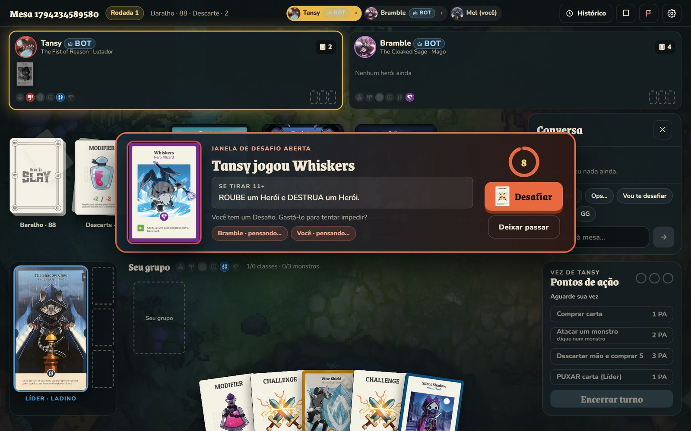
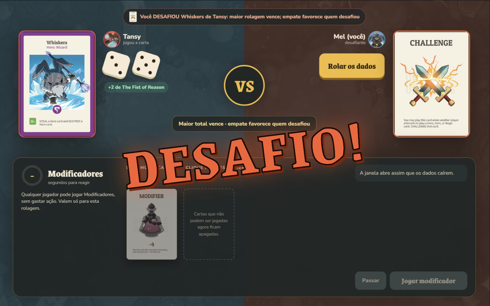
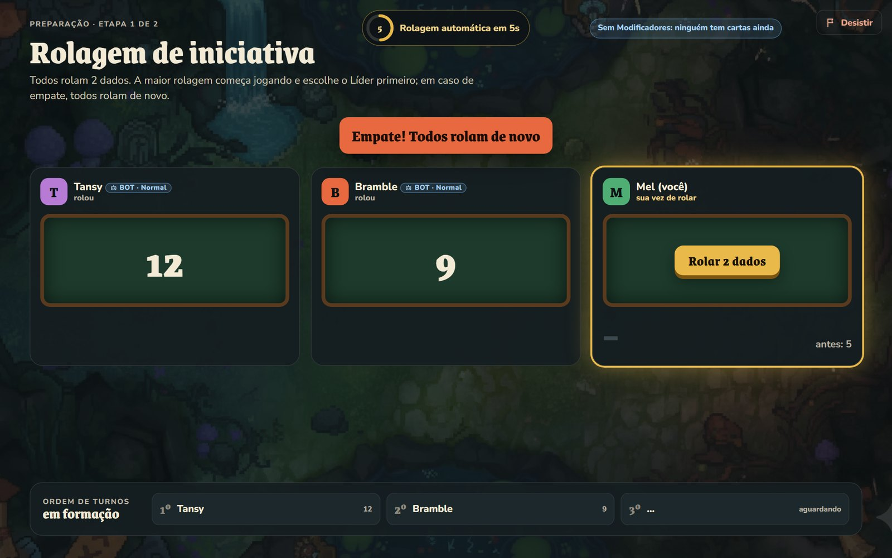
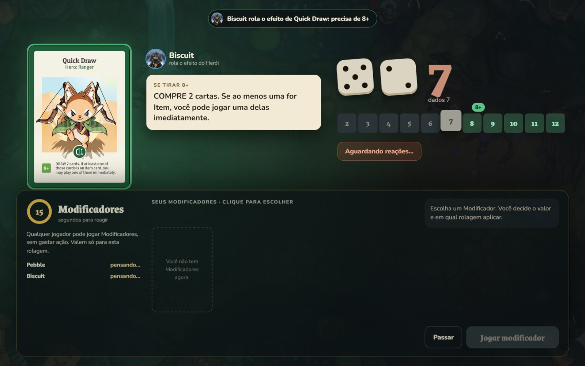
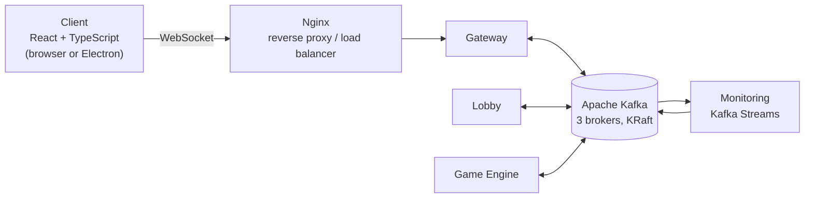

<div align="center">

# HtS Online

**An unofficial, fan-made online version of the card game _Here to Slay_.**
Build a party of heroes, challenge your friends' plays, flip a roll with a modifier at the last second, and slay three monsters (or gather all six classes) to win.


**[Read the full write-up on my website →](https://joaogbarros.pages.dev/en/projects/here-to-slay/)**

</div>

<p align="center">
  
  
  
  
</p>

## About

I built HtS Online to study distributed systems in practice, and to keep playing a game I love with friends who can't sit at the same table. It started as a single server and grew into an event-driven backend where every service talks only through Apache Kafka.

The story of how it was built, part by part, from the first playable match to the rules engine, the interface and the bots, is on my website: **[Here to Slay, project page and articles](https://joaogbarros.pages.dev/en/projects/here-to-slay/)**.

## Highlights

- **The whole base game, online.** Heroes, items, magic, monsters, three action points per turn and both win conditions.
- **Real-time reactions.** Every card played opens a Challenge window, and every roll opens a Modifier window, for every player at the table.
- **A rules engine built for card effects.** Each card is a short script of steps; a step can pause the match to wait for a player's choice and resume where it stopped.
- **Event-driven backend.** Gateway, Lobby and Engine never call each other: all traffic and all persisted state go through Kafka topics.
- **Live match insights with Kafka Streams.** A read-only service watches the game and raises moments like *First Blood* and *Combo*, using time windows, state stores and Allen's interval algebra.
- **Resilient sessions.** Reloading or reconnecting puts you back in the match you were playing.
- **Desktop and browser.** The same React client runs in the browser and as an Electron app for Windows and macOS, in Portuguese, English and Spanish.

## Architecture



- **Gateway** is the only WebSocket endpoint. It has no game logic: it turns client messages into Kafka events and routes results back to the right players.
- **Lobby** and **Game Engine** consume their action topics, apply the change and publish the new state. Lobbies and matches are partitioned by id, so each one is always handled by a single instance, in order.
- **Compacted topics** hold the latest state of every lobby and match. A restarted service rebuilds its memory by replaying them; there is no database.
- **Monitoring** only reads the game topics and only writes alerts, so a bug there can never affect a match.

## Tech stack

| Layer | Technologies |
|---|---|
| Client | React, TypeScript, Vite, Tailwind CSS, GSAP, Electron |
| Backend | Java 21, Maven, Java-WebSocket, Apache Kafka clients, Kafka Streams |
| Infrastructure | Docker Compose, Apache Kafka (KRaft mode), Nginx |

## Getting started

**Prerequisites:** Docker with Docker Compose, and Node.js 20 or newer.

1. **Start the backend** (the Kafka cluster, every service and the Nginx load balancer):

   ```bash
   docker compose up --build
   ```

2. **Start the client** in another terminal:

   ```bash
   npm install
   npm run dev
   ```

   This runs Vite and opens the Electron app with hot reload. The client connects to `ws://localhost:8889`.

3. **Inspect Kafka (optional):** Kafka UI runs at [http://localhost:8080](http://localhost:8080) with every topic, partition and message.

To build the Windows desktop app, run `npm run dist:win`; the executable is written to `release/`.

## Project structure

```
├── backend/          Java 21 services: gateway, lobby, match engine, rules engine, Kafka Streams monitoring
├── src/              React + TypeScript client and the Electron main process
├── nginx/            WebSocket load balancer in front of the gateways
├── deploy/           Production deploy and macOS packaging scripts
├── docs/             Kafka Streams notes and README images
└── docker-compose.yml
```

## Legal notice

- **Unofficial fan project.** HtS Online is not an official product and has no affiliation with, sponsorship from or endorsement by **Unstable Games** or **TeeTurtle**.
- **Their game, their art.** *Here to Slay*, the publishers' names, the card names, the rules and all artwork belong to their respective owners. I claim no ownership of any of it. Card images come from the official Unstable Games wiki.
- **Non-commercial.** The project is free, is not sold and earns no revenue. It exists for learning and as a portfolio piece.
- **Buy the real game.** If you enjoy it, support the creators and get *Here to Slay* at [unstablegames.com](https://www.unstablegames.com).
- **Takedown requests.** Rights holders who want any content removed can [open an issue](https://github.com/JoaoGBarros/HereToSlay/issues), and it will be taken down.
- **Third-party audio.** Music and sound effects belong to their authors and keep their original licenses.
- **Code.** The source code has no open-source license; all rights reserved by the author.

---

<div align="center">

Made by **[João Gabriel de Barros Rocha](https://github.com/JoaoGBarros)** · [Website](https://joaogbarros.pages.dev/en/projects/here-to-slay/)

</div>
