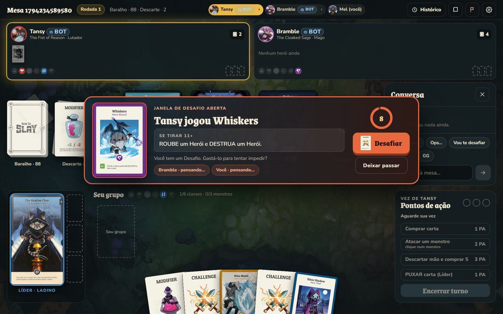
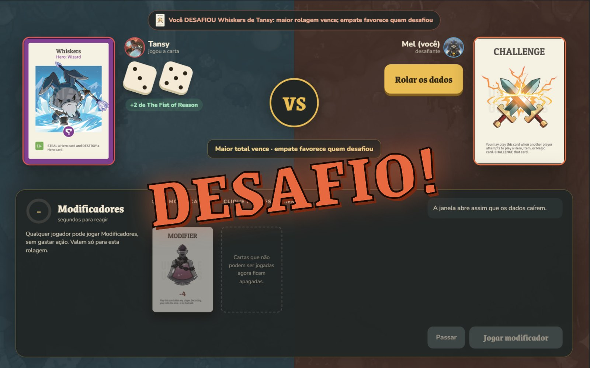
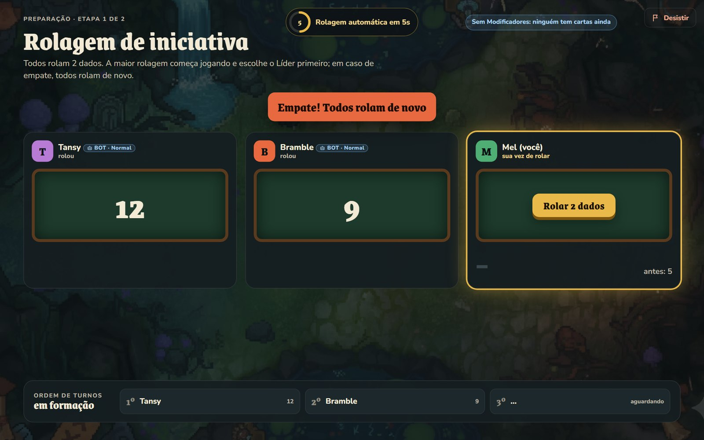
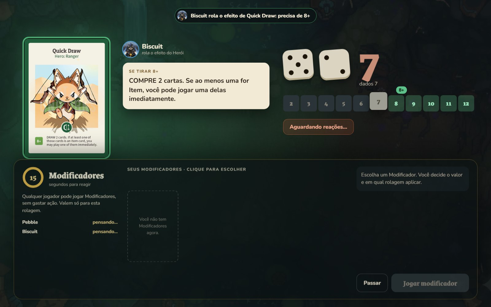
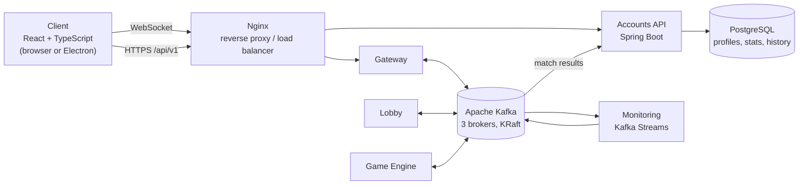

<div align="center">

# HtS Online

**An unofficial, fan-made online version of the card game _Here to Slay_.**
Build a party of heroes, challenge your friends' plays, flip a roll with a modifier at the last second, and slay three monsters (or gather all six classes) to win.


**[Read the full write-up on my website →](https://joaogbarros.com/en/projects/here-to-slay/)**

</div>

<p align="center">
  
  
  
  
</p>

## About

I built HtS Online to study distributed systems in practice, and to keep playing a game I love with friends who can't sit at the same table. It started as a single server and grew into an event-driven backend where the game services talk only through Apache Kafka.

The story of how it was built, part by part, from the first playable match to the rules engine, the interface and the bots, is on my website: **[Here to Slay, project page and articles](https://joaogbarros.com/en/projects/here-to-slay/)**.

## Highlights

- **The whole base game, online.** Heroes, items, magic, monsters, three action points per turn and both win conditions.
- **Real-time reactions.** Every card played opens a Challenge window, and every roll opens a Modifier window, for every player at the table.
- **A rules engine built for card effects.** Each card is a short script of steps; a step can pause the match to wait for a player's choice and resume where it stopped.
- **Event-driven backend.** Gateway, Lobby and Engine never call each other: every game event and all match state go through Kafka topics.
- **Live match insights with Kafka Streams.** A read-only service watches the game and raises moments like *First Blood* and *Combo*, using time windows, state stores and Allen's interval algebra.
- **Resilient sessions.** Reloading or reconnecting puts you back in the match you were playing.
- **Accounts, stats and history.** Sign in with Firebase, either with an e-mail and password or a Google account, and pick a username. Your profile keeps lifetime wins and losses, how the wins came (six classes, three monsters or last one standing), monsters slain and the history of every match you played.
- **Desktop and browser.** The same React client runs in the browser and as an Electron app for Windows and macOS, in Portuguese, English and Spanish.

## Architecture



- **Gateway** is the only WebSocket endpoint. It has no game logic: it turns client messages into Kafka events and routes results back to the right players.
- **Lobby** and **Game Engine** consume their action topics, apply the change and publish the new state. Lobbies and matches are partitioned by id, so each one is always handled by a single instance, in order.
- **Compacted topics** hold the latest state of every lobby and match. A restarted service rebuilds its memory by replaying them; a running match needs no database.
- **Monitoring** only reads the game topics and only writes alerts, so a bug there can never affect a match.
- **Accounts API** is the only service with a database. It verifies Firebase ID tokens, owns usernames and profiles, and consumes the match results the engine publishes, turning them into lifetime stats and match history. PostgreSQL holds only what outlives a match: players and finished matches.

## Tech stack

| Layer | Technologies |
|---|---|
| Client | React, TypeScript, Vite, Tailwind CSS, GSAP, Electron, Firebase Auth |
| Game backend | Java 21, Maven, Java-WebSocket, Apache Kafka clients, Kafka Streams |
| Accounts | Java 21, Spring Boot, Spring Security, PostgreSQL, Flyway |
| Infrastructure | Docker Compose, Apache Kafka (KRaft mode), Nginx, k3s |

## Getting started

**Prerequisites:** Docker with Docker Compose, Node.js 20 or newer, and a Firebase project — the client signs in with Firebase and the accounts API verifies those tokens.

1. **Configure the environment.** Copy `.env.example` to `.env` and fill in `DB_PASSWORD`, `FIREBASE_PROJECT_ID` and the `VITE_FIREBASE_*` values. Save a Firebase service account key as `secrets/firebase-service-account.json`; compose mounts it read-only into the accounts API. Vite reads the `VITE_*` values at build time.

2. **Start the backend** (Kafka, every service, PostgreSQL, the accounts API and the Nginx load balancer):

   ```bash
   docker compose up --build
   ```

3. **Start the client** in another terminal:

   ```bash
   npm install
   npm run dev
   ```

   This runs Vite and opens the Electron app with hot reload. The client connects to `ws://localhost:8889` and to the accounts API at `http://localhost:8080/api/v1`.

4. **Inspect Kafka (optional):** Kafka UI runs at [http://localhost:8090](http://localhost:8090) with every topic, partition and message.

To build the Windows desktop app, run `npm run dist:win`; the executable is written to `release/`.

## Deploy

The client and the game server are deployed separately. The client is a set of static files served by the server's nginx from `/var/www/heretoslay`; the backend runs on a single-node k3s cluster behind it.

**Client only**, after a change that touches no backend code:

```bash
npm run build
scp -r dist/* user@server:/var/www/heretoslay/
```

Everything in `dist/` goes directly into that folder — copying the `dist` directory itself would leave the site one level too deep, and nginx would keep serving the previous build. Nginx serves these files from disk, so nothing needs restarting.

Uploaded from Windows, `scp` creates every new directory with mode 700, which nginx cannot enter: the HTML loads and all assets under it return 403. Finish with `ssh user@server 'chmod -R a+rX /var/www/heretoslay'`. Asset names carry a content hash, so a rebuild only really changes `index.html`, `index-*.js` and `index-*.css`; files that are no longer referenced stay behind and are harmless.

**Everything**, backend and client together, to the k3s server:

```bash
deploy/deploy-k3s.sh
```

It builds the game backend and the accounts API images, imports them straight into the server's k3s (there is no registry), applies `k8s/` with the new image tag, waits for the rollouts and replaces the web folder.

`deploy/deploy.sh` is the older Docker Compose path: it ships the game services only, without PostgreSQL or the accounts API, so sign-in is not available there. Both scripts are bash, read `HOST` from the git-ignored `deploy/.env.deploy` and, on Windows, run from Git Bash. The nginx site configuration used on the server is `deploy/nginx-heretoslay.conf`.

## Project structure

```
├── accounts-api/     Spring Boot service for accounts, stats and match history (PostgreSQL)
├── backend/          Java 21 services: gateway, lobby, match engine, rules engine, Kafka Streams monitoring
├── src/              React + TypeScript client and the Electron main process
├── nginx/            WebSocket load balancer in front of the gateways
├── k8s/              Kubernetes manifests for the production k3s cluster
├── deploy/           Deploy and packaging scripts
├── docs/             Kafka Streams notes and README images
└── docker-compose.yml
```

## Legal notice

- **Unofficial fan project.** HtS Online is not an official product and has no affiliation with, sponsorship from or endorsement by **Unstable Games** or **TeeTurtle**.
- **Their game, their art.** *Here to Slay*, the publishers' names, the card names, the rules and all artwork belong to their respective owners. I claim no ownership of any of it. Card images come from the official Unstable Games wiki.
- **Non-commercial.** The project is free, is not sold and earns no revenue. It exists for learning and as a portfolio piece.
- **Attribution in the client.** The login, lobby and profile screens carry a footer restating this notice, with links to the official store and to the project's documentation.
- **Buy the real game.** If you enjoy it, support the creators and get *Here to Slay* at the [official store](https://teeturtle.com/products/here-to-slay-base-game) — the same link the client's footer uses.
- **Takedown requests.** Rights holders who want any content removed can [open an issue](https://github.com/JoaoGBarros/HereToSlay/issues), and it will be taken down.
- **Third-party audio.** Music and sound effects belong to their authors and keep their original licenses.
- **Code.** The source code has no open-source license; all rights reserved by the author.

---

<div align="center">

Made by **[João Gabriel de Barros Rocha](https://github.com/JoaoGBarros)** · [Website](https://joaogbarros.com/en/projects/here-to-slay/)

</div>
